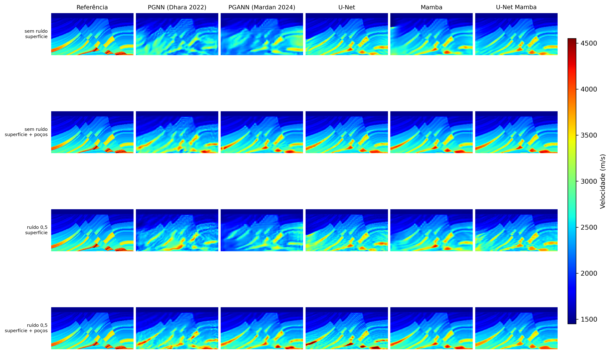
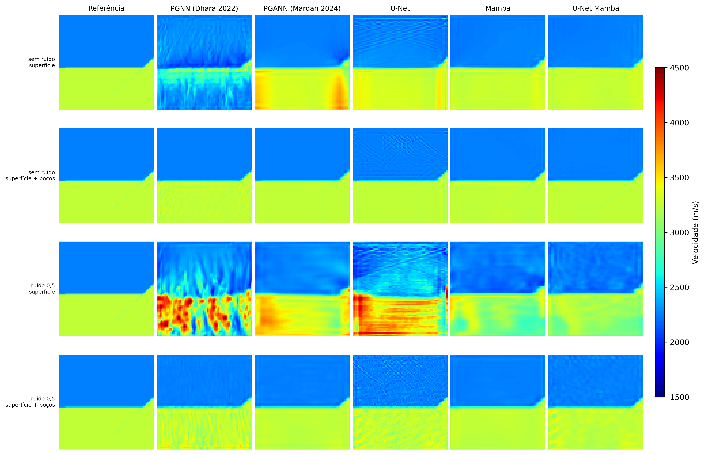

# TCC-FWI

Este repositório contém o código experimental do TCC “Preservação de Informação Espacial em Redes Neurais para Inversão de Forma de Onda Completa Guiada pela Física”. O trabalho compara cinco arquiteturas para reconstruir modelos de velocidade a partir de dados sísmicos, estudando como conexões de salto e blocos Mamba afetam a preservação da informação espacial.

## Comece por aqui

Antes de executar qualquer fluxo, ajuste os caminhos em `config/paths.json` para os dados e checkpoints disponíveis na sua máquina. Os módulos `network/train.py`, `network/training_runner.py`, `network/evaluation.py` e `tuning/optuna/` implementam os fluxos; use os pontos de entrada abaixo.

| Objetivo | Ponto de entrada | Quando usar |
| --- | --- | --- |
| Treinar modelos | `run_training.py` | Fluxo padrão de treinamento. Consulte primeiro `python run_training.py --list-models` e `python run_training.py --list-datasets`. |
| Avaliar checkpoints | `02_evaluate_models.ipynb` | Avaliação dos checkpoints já treinados, conforme `config/evaluation_presentation.json`. Não inicia treinamento. |
| Explorar os dados | `00_data_analysis.ipynb` | Análise exploratória; não é necessário para treinar ou avaliar. |
| Ajustar hiperparâmetros | Um notebook `01_tune_*_hyperparams_optuna.ipynb` | Opcional; escolha o notebook do modelo que deseja ajustar. |

Para conferir uma fila de treinamento sem iniciar o cálculo, use um modelo e conjunto explícitos com `--dry-run`, por exemplo:

```bash
python run_training.py --models unet --datasets Marmousi --dry-run
```

Remova `--dry-run` para iniciar o treinamento depois de conferir a fila. Sem argumentos, `run_training.py` abre a seleção interativa no terminal.

Para abrir os notebooks neste ambiente, instale JupyterLab e o kernel Python (opcional; não fazem parte de `requirements.txt`): `python -m pip install jupyterlab ipykernel`, depois execute `jupyter lab` na raiz do repositório.

O padrão para uma execução nova é `v1` no treinamento e na avaliação. Os três notebooks Optuna também usam a versão de estudo `marmousi500_fixed_v1`; o nome completo segue `<model_name>_<dataset_names>_<optuna_study_version>`, então cada modelo e conjunto tem seu próprio estudo. A troca do padrão não remove os registros antigos dos bancos SQLite locais.

| Modelo ajustado | Notebook Optuna | Versão de estudo configurada |
| --- | --- | --- |
| Mamba | `01_tune_mamba_hyperparams_optuna.ipynb` | `marmousi500_fixed_v1` |
| PGANN | `01_tune_pgann_hyperparams_optuna.ipynb` | `marmousi500_fixed_v1` |
| U-Net | `01_tune_unet_hyperparams_optuna.ipynb` | `marmousi500_fixed_v1` |

Optuna é opcional e pode executar muitas épocas por tentativa. O banco local preserva estudos anteriores; o novo padrão abre os estudos nomeados com `marmousi500_fixed_v1` ou os cria se ainda não existirem.

## Arquiteturas avaliadas

- **PGNN de Mardan baseada em Dhara (2022):** autoencoder convolucional que comprime os sismogramas em um vetor latente e o decodifica em um modelo de velocidades, com a propagação física compondo o treinamento.
- **PGANN de Mardan:** reconstrução local da topologia descrita por Mardan, com latente espacial e três ramos de atenção combinados à saída do decodificador principal.
- **U-Net:** codificador e decodificador convolucionais com conexões de salto que transferem características espaciais entre as etapas.
- **Mamba:** blocos convolucionais e Mamba no codificador e decodificador, sem conexões de salto.
- **U-Net Mamba:** combina os blocos Mamba com as conexões de salto da U-Net.

Consulte a [documentação dos modelos](docs/index.md) para detalhes de implementação, configurações e figuras.

## Resultados apresentados no TCC

Os mapas comparam os cinco modelos na amostra 0 de Marmousi e FlatFault_A.





A pasta de [figuras de resultados](docs/figures/results/) mantém os mapas de velocidade das amostras 0 e 1 dos quatro conjuntos e os três gráficos métricos referenciados no capítulo de resultados: MAE de Marmousi e MSE de FlatFault_A e CurveFault_B. Gráficos de latência e pico de memória GPU não são incluídos nessa seleção. A avaliação completa continua salvando seus artefatos em `results/evaluation/<versão>/`.

## Instalação

### Requisitos gerais

- Ubuntu Linux (x86-64).
- Para usar Mamba com GPU: GPU NVIDIA e driver NVIDIA para Linux compatível.
- Python 3.13.
- Git, Miniconda e `pip`.
- PyTorch. A avaliação do Mamba exige CUDA e, neste roteiro, uma GPU NVIDIA; U-Net, PGNN e PGANN podem ser executados em CPU.
- CUDA Toolkit com `nvcc` disponível quando o Mamba for compilado a partir do código-fonte.

Os caminhos de dados, checkpoints e resultados ficam em `config/paths.json`. Edite esse arquivo para apontar às pastas da sua máquina; caminhos relativos são resolvidos a partir da raiz do repositório.

O PyTorch instalado com CUDA inclui as bibliotecas de execução, mas não necessariamente o compilador `nvcc`. O `nvcc` faz parte do CUDA Toolkit e é necessário para compilar as extensões CUDA do Mamba.

### Instalação recomendada: Ubuntu

Este é o caminho recomendado quando os modelos Mamba serão usados. O pacote `mamba-ssm` e suas extensões CUDA têm suporte principal para Linux. Instale no Ubuntu um driver NVIDIA compatível com a GPU e com a versão CUDA usada.

#### 1. Preparar o Ubuntu e verificar a GPU

No terminal do Ubuntu, instale as ferramentas básicas:

```bash
sudo apt update
sudo apt install -y build-essential git wget
```

Se for usar Mamba com GPU, verifique se o driver NVIDIA está funcionando:

```bash
nvidia-smi
```

Se `nvidia-smi` não funcionar, instale ou atualize o driver recomendado para sua placa com `sudo ubuntu-drivers install`, reinicie o Ubuntu e verifique novamente. A instalação do Python ou do Mamba não corrige problemas no driver.

#### 2. Instalar o Miniconda

Execute estes comandos no terminal do Ubuntu:

```bash
cd /tmp
wget https://repo.anaconda.com/miniconda/Miniconda3-latest-Linux-x86_64.sh -O miniconda.sh
bash miniconda.sh -b -p "$HOME/miniconda3"

"$HOME/miniconda3/bin/conda" init bash
source "$HOME/.bashrc"
```

#### 3. Criar o ambiente Python

```bash
conda create -n tcc -c conda-forge --override-channels python=3.13 pip -y
conda activate tcc
```

#### 4. Instalar o CUDA Toolkit

Uma opção é instalar o toolkit no próprio ambiente Conda:

```bash
conda install -y --override-channels \
  -c nvidia/label/cuda-12.6.0 \
  -c conda-forge \
  cuda-toolkit
```

Configure o ambiente e confirme que o compilador está disponível:

```bash
export CUDA_HOME="$CONDA_PREFIX"
export PATH="$CUDA_HOME/bin:$PATH"
export LD_LIBRARY_PATH="$CUDA_HOME/lib64:${LD_LIBRARY_PATH:-}"

nvcc --version
```

O resultado precisa mostrar uma versão do CUDA Toolkit. O valor exibido por `nvidia-smi` é a capacidade CUDA do driver; ele não substitui o `nvcc`.

#### 5. Instalar PyTorch e Mamba

```bash
python -m pip install --upgrade pip setuptools wheel ninja packaging
```

Use as versões fixadas abaixo. O Mamba `2.3.2.post1` possui wheels publicados até o PyTorch `2.10.0`. Essa combinação usa `triton==3.6.0`; o PyTorch `2.7.1` não é compatível, pois exige `triton==3.3.1`.

```bash
python -m pip install torch==2.10.0 torchvision==0.25.0 torchaudio==2.10.0 \
  --index-url https://download.pytorch.org/whl/cu126
```

Para compilar a extensão CUDA do Mamba:

```bash
export MAMBA_SKIP_CUDA_BUILD=FALSE
export MAMBA_FORCE_BUILD=FALSE
export MAMBA_KEEP_CUDA_BUILD=TRUE
export MAX_JOBS=1

# Estas constraints mantêm o par compatível com o wheel do Mamba.
printf 'torch==2.10.0\ntriton==3.6.0\n' > /tmp/tcc-mamba-constraints.txt

python -m pip install --no-build-isolation --no-cache-dir \
  -c /tmp/tcc-mamba-constraints.txt \
  mamba-ssm==2.3.2.post1 causal-conv1d

rm -f /tmp/tcc-mamba-constraints.txt
```

Depois, instale as dependências do projeto:

```bash
cd /caminho/para/o-repositorio
python -m pip install --no-build-isolation -r requirements.txt
```

#### 6. Verificar a instalação

```bash
python -c "import torch; print(torch.__version__); print('CUDA:', torch.cuda.is_available()); print('CUDA do PyTorch:', torch.version.cuda)"
python -c "from mamba_ssm.modules.mamba_simple import Mamba; print('Mamba OK')"
```

O primeiro comando deve mostrar `CUDA: True`. O segundo confirma que a extensão necessária para o Mamba foi instalada e importada.

### Gerar os dados Marmousi

Com as dependências do projeto instaladas e na raiz do repositório, gere os dados sísmicos e os modelos de velocidade Marmousi a partir dos arquivos em `datasets/Marmousi/source/`:

```bash
python data/generate_marmousi.py
```

O script usa CUDA quando disponível; para escolher o dispositivo explicitamente, informe `--device cuda` ou `--device cpu`. Os arquivos gerados são `datasets/Marmousi/data/data1.npy` e `datasets/Marmousi/model/model1.npy`; uma nova execução substitui esses arquivos.

### Problemas comuns

#### Conflito entre `torch`, `triton` e `mamba-ssm`

Não combine `torch==2.7.1` com `mamba-ssm==2.3.2.post1`: o primeiro exige `triton==3.3.1`, enquanto o segundo exige `triton>=3.5.0`. Em um ambiente que já passou por essa tentativa, corrija as versões e reinstale o Mamba:

```bash
conda activate tcc

export CUDA_HOME="$CONDA_PREFIX"
export PATH="$CUDA_HOME/bin:$PATH"
export LD_LIBRARY_PATH="$CUDA_HOME/lib64:${LD_LIBRARY_PATH:-}"
export MAX_JOBS=1

python -m pip uninstall -y mamba-ssm causal-conv1d triton
python -m pip install --force-reinstall --no-cache-dir \
  torch==2.10.0 torchvision==0.25.0 torchaudio==2.10.0 \
  --index-url https://download.pytorch.org/whl/cu126

export MAMBA_SKIP_CUDA_BUILD=FALSE
export MAMBA_FORCE_BUILD=FALSE
export MAMBA_KEEP_CUDA_BUILD=TRUE
printf 'torch==2.10.0\ntriton==3.6.0\n' > /tmp/tcc-mamba-constraints.txt

python -m pip install --no-build-isolation --no-cache-dir \
  -c /tmp/tcc-mamba-constraints.txt \
  mamba-ssm==2.3.2.post1 causal-conv1d

rm -f /tmp/tcc-mamba-constraints.txt
python -m pip check
```

Se o ambiente estiver muito misturado com tentativas anteriores, é mais seguro criar um ambiente novo:

```bash
conda create -n tcc-mamba -c conda-forge --override-channels python=3.13 pip -y
conda activate tcc-mamba
```

#### `conda: command not found`

Instale o Miniconda conforme a seção acima e carregue sua inicialização no terminal atual:

```bash
source "$HOME/miniconda3/etc/profile.d/conda.sh"
conda activate tcc
```

#### `nvidia-smi` funciona, mas `nvcc` não é encontrado

O driver está visível, mas o CUDA Toolkit não foi instalado ou configurado no Ubuntu. Instale o `cuda-toolkit`, configure `CUDA_HOME` e confira novamente com `nvcc --version`.

#### Erro `bare_metal_version` no Mamba

Esse erro aparece quando versões antigas do `mamba-ssm` tentam compilar a extensão CUDA sem encontrar `nvcc`. No Ubuntu, instale o toolkit e compile o Mamba com `MAMBA_SKIP_CUDA_BUILD=FALSE`.

#### `ModuleNotFoundError: selective_scan_cuda`

O Mamba foi instalado sem a extensão CUDA. Verifique `nvcc --version`, `CUDA_HOME`, `torch.cuda.is_available()` e reinstale `mamba-ssm` no Ubuntu com a compilação CUDA habilitada.
