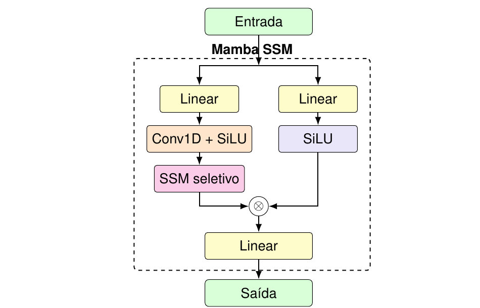
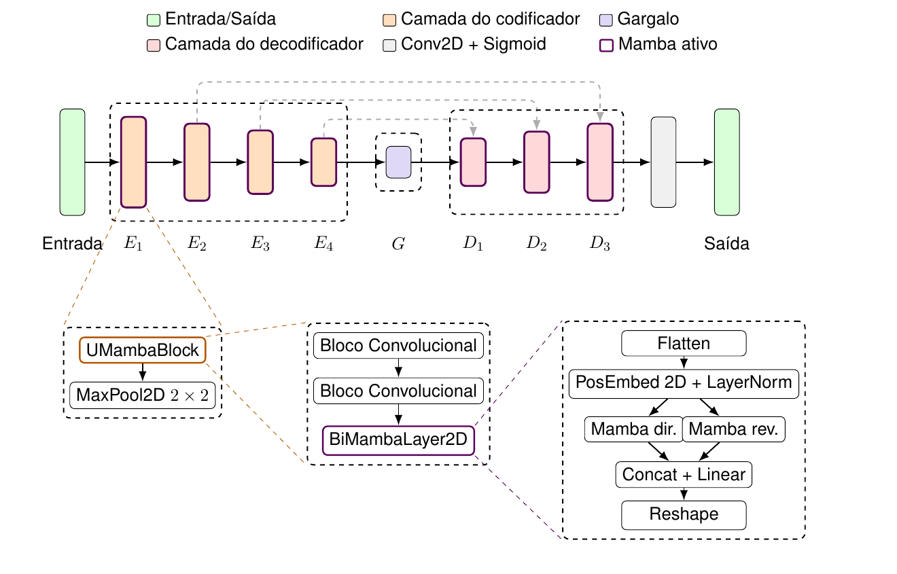

# Mamba e U-Net Mamba

Os dois identificadores usam `MambaUNet` de [mamba.py](../network/models/mamba.py). A diferença arquitetural entre as configurações é o uso das conexões de salto: `mamba` desativa os atalhos e `unetmamba` concatena as características do codificador com as entradas correspondentes do decodificador.

## Blocos e fluxo tensorial

`UMambaBlock` aplica dois `SubBlock`s e, quando habilitada, uma `BiMambaLayer2D` (componentes definidos no [índice de modelos](index.md)). Essa camada transforma o mapa `[B, C, H, W]` em uma sequência `[B, H·W, C]`, adiciona embeddings das coordenadas 2D normalizadas e aplica LayerNorm. Duas instâncias Mamba processam a sequência nas direções direta e reversa. As saídas são concatenadas, projetadas de volta para `C` canais e reorganizadas como mapa 2D.

O codificador usa `MambaDownBlock`s e o gargalo usa `UMambaBlock`. O decodificador usa `MambaUpBlock`s. Na variante U-Net Mamba, as características guardadas pelo codificador são concatenadas antes dos blocos correspondentes do decodificador.

Esta implementação achata temporariamente cada mapa em uma sequência 1D e usa duas passagens Mamba. Ela não implementa VMamba nem SS2D.

## Configuração comum

| Parâmetro | Valor |
| --- | ---: |
| `n_blocks_encoder`, `n_blocks_decoder` | 4; 3 |
| `mamba_base_channels` | 32 |
| `use_mamba_encoder`, `use_mamba_bottleneck`, `use_mamba_decoder` | `true`; `false`; `true` |
| `mamba_d_state`, `mamba_d_conv`, `mamba_expand` | 8; 4; 4 |
| `mamba_dropout` | 0,0 |
| `mamba_conv_kernel_size` | 3 |
| `use_pos_embed` | `true` |
| `final_out_channels` | 1 |

Com `mamba_base_channels=32`, os quatro blocos do codificador produzem 64, 128, 256 e 512 canais. O gargalo tem 512 canais. Os três blocos do decodificador produzem 128, 64 e 32 canais.

## Mamba

O identificador `mamba` configura `use_skip_connections=false`. As características intermediárias do codificador não são concatenadas ao decodificador, que recebe apenas a saída do gargalo.

## U-Net Mamba

O identificador `unetmamba` configura `use_skip_connections=true`. As saídas dos três blocos codificadores mais profundos são concatenadas aos blocos decodificadores correspondentes. Com os canais atuais, esses mapas têm 512, 256 e 128 canais, nessa ordem.

## Configurações

| Identificador | `use_skip_connections` | Configuração |
| --- | --- | --- |
| `mamba` | `false` | [mamba_config.json](../config/models/mamba_config.json) |
| `unetmamba` | `true` | [unetmamba_config.json](../config/models/unetmamba_config.json) |

## Diagramas

O diagrama conceitual mostra as operações do bloco Mamba SSM.

O esquema da U-Net Mamba mostra as conexões de salto e a composição dos blocos convolucionais e Mamba descritos nesta página.

