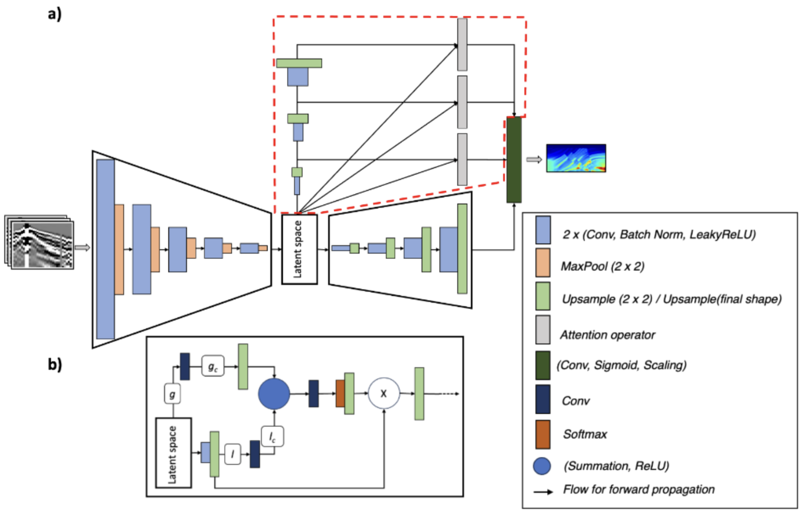

# PGANN de Mardan (2024)

Identificador da fábrica: `pgann_mardan_2024`.

## Arquitetura implementada

`PGANNMardan2024` está implementada em [pgann_mardan_2024.py](../network/models/pgann_mardan_2024.py). O codificador contém cinco blocos convolucionais de redução, cada um com duas convoluções, BatchNorm, LeakyReLU e MaxPool2d. O mapa latente mantém suas dimensões espaciais e alimenta dois caminhos independentes:

1. O decodificador principal contém quatro blocos de aumento e produz a imagem completa de velocidade.
2. O decodificador de atenção contém três blocos. Cada bloco fornece características a um operador de atenção guiado pelo latente.

Cada operador projeta o latente e as características do caminho paralelo, soma as projeções, aplica ReLU e gera logits espaciais. Softmax é aplicado sobre as posições espaciais. O mapa resultante pondera as características do caminho paralelo, que são redimensionadas à grade final. As três saídas ponderadas são concatenadas com a saída do decodificador principal e projetadas por uma convolução 3×3, sigmoide e escalonamento para os limites de velocidade.

O codificador reutiliza `Block` de [networks.py](../network/models/pinn_fwi/networks.py). O decodificador principal e o caminho de atenção têm parâmetros próprios. Larguras de canal, kernels, redução da projeção e detalhes de interpolação são decisões desta reconstrução local; ela implementa a topologia descrita por Mardan, mas não é uma reprodução exata camada a camada.

## Parâmetros arquiteturais da configuração

| Parâmetro | Valor |
| --- | ---: |
| `n_blocks_encoder`, `n_blocks_decoder` | 5; 4 |
| `pgann_encoder_channel_scale` | 1,0 |
| `pgann_decoder_channel_scale` | 0,5 |
| `pgann_attention_latent_kernel_size` | 5 |
| `pgann_attention_feature_kernel_size` | 1 |
| `pgann_attention_score_kernel_size` | 3 |
| `pgann_attention_reduction` | 8 |
| `model_output_min`, `model_output_max` | 0,0; 1,0 |
| `final_out_channels` | 1 |

Na configuração Marmousi, `C_s=22`. O codificador produz 44, 88, 176, 352 e 704 canais; os canais do decodificador principal são 176, 88, 44 e 22. As três projeções de atenção usam, respectivamente, 22, 11 e 5 canais.

Configuração completa: [pgann_mardan_2024_config.json](../config/models/pgann_mardan_2024_config.json).

## Diagrama

O diagrama mostra a topologia de atenção publicada. As escolhas locais de largura de canais, kernels e compartilhamento de pesos estão especificadas acima e no código.

