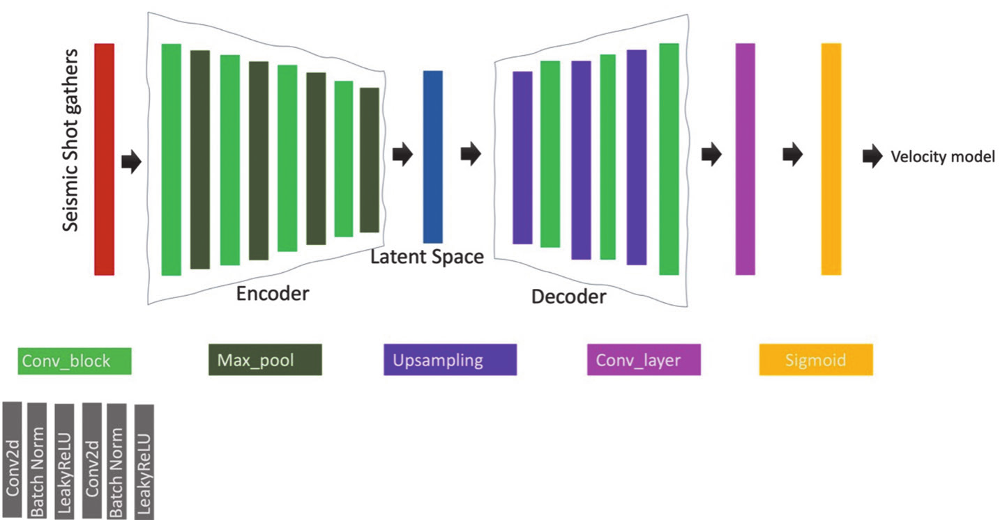
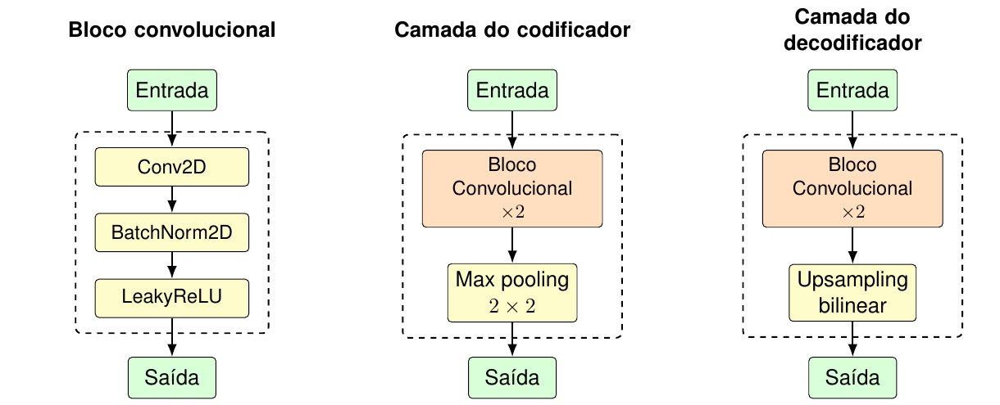

# PGNN proposta por Dhara

Identificador da fábrica: `pgnn_dhara_2022`.

## Origem e papel no artigo de Mardan (2024)

Esta implementação foi disponibilizada por Amir Mardan no repositório [`pinn_fwi`](https://github.com/AmirMardan/pinn_fwi). O código inclui a PGNN baseada na arquitetura proposta por Dhara e Sen (2022), que Mardan usa como modelo de referência para compará-la com a PGANN apresentada em seu artigo. Assim, `pgnn_dhara_2022` identifica aqui a PGNN de Dhara disponibilizada no código de Mardan; a arquitetura PGANN é documentada separadamente.

## Arquitetura implementada

A fábrica instancia `Autoencoder` em [networks.py](../network/models/pinn_fwi/networks.py). O codificador contém cinco blocos. Cada bloco aplica duas convoluções 3×3, cada uma seguida de BatchNorm e LeakyReLU com inclinação 0,2, e reduz a resolução com MaxPool2d de fator 2. O número de canais cresce de `2 C_s` até `32 C_s`.

O tensor codificado é achatado e projetado por uma camada totalmente conectada para um vetor de 392 elementos. O decodificador reorganiza esse vetor como `[1, 14, 28]` por amostra e aplica quatro blocos convolucionais com aumento bilinear de resolução. Os canais passam de 1 para 2, 4, 8 e 16. A última etapa ajusta a saída à grade de velocidade fornecida pelo pipeline; a convolução final 3×3 e a sigmoide geram um canal entre `m_min` e `m_max`.

O achatamento do codificador inclui a dimensão do lote. Por isso, a configuração associada a essa arquitetura fixa `model_batch_size` em 1.

## Parâmetros arquiteturais da configuração

| Parâmetro | Valor |
| --- | ---: |
| `n_blocks_encoder` | 5 |
| `n_blocks_decoder` | 4 |
| `final_size_encoder` | 392 |
| `decoder_initial_shape` | `[14, 28]` |
| `model_batch_size` | 1 |
| `model_output_min`, `model_output_max` | 0,0; 1,0 |
| `final_out_channels` | 1 |

Configuração completa: [pgnn_dhara_2022_config.json](../config/models/pgnn_dhara_2022_config.json). A implementação aplica à FWI a arquitetura PGNN associada a Dhara e Sen (2022), na formulação de Mardan (2024).

## Diagramas

A primeira imagem mostra a arquitetura PGNN de Dhara e Sen (2022), que serve de base para a formulação usada por Mardan (2024).

O segundo diagrama detalha os blocos convolucionais usados pelo codificador e pelo decodificador. Ele não representa sozinho o autoencoder completo.

