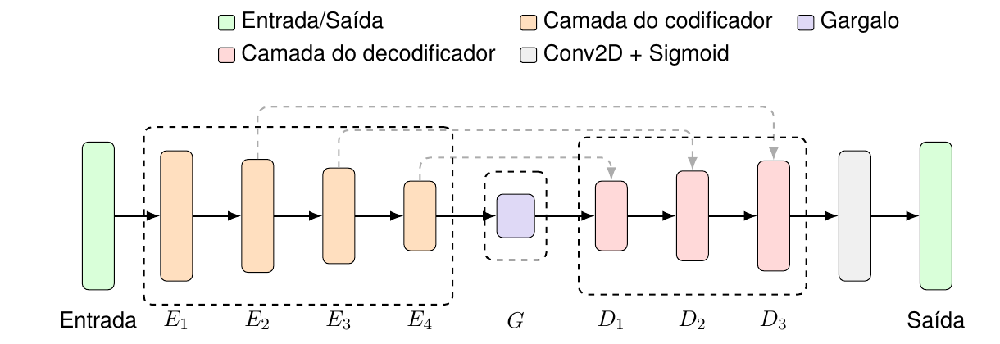

# U-Net

Identificador da fábrica: `unet`.

## Arquitetura implementada

`UNet` está implementada em [unet.py](../network/models/unet.py) e usa `DownBlock`, `SubBlock` e `UpBlock` de [network/blocks/cnn](../../blocks/cnn/). As funções desses componentes estão descritas no [índice de modelos](index.md).

O codificador tem quatro `DownBlock`s. Para `C_s` canais de entrada, os mapas de características têm `2 C_s`, `4 C_s`, `8 C_s` e `16 C_s` canais. O gargalo contém dois `SubBlock`s e eleva a largura para `32 C_s` canais.

O decodificador tem três `UpBlock`s. Antes de cada um, concatena o tensor corrente com as características do nível correspondente do codificador. As dimensões são alinhadas antes da concatenação; a última etapa é alinhada à grade de saída. A convolução 3×3 e a sigmoide finais produzem um canal de velocidade normalizada.

## Parâmetros arquiteturais da configuração

| Parâmetro | Valor |
| --- | ---: |
| `n_blocks_encoder` | 4 |
| `n_blocks_decoder` | 3 |
| `final_out_channels` | 1 |
| Conexões de salto | 3 níveis do codificador |

As dimensões da saída `final_spatial_shape` são fornecidas pelo conjunto de dados em tempo de execução. Configuração completa: [unet_config.json](../config/models/unet_config.json).

## Diagrama

